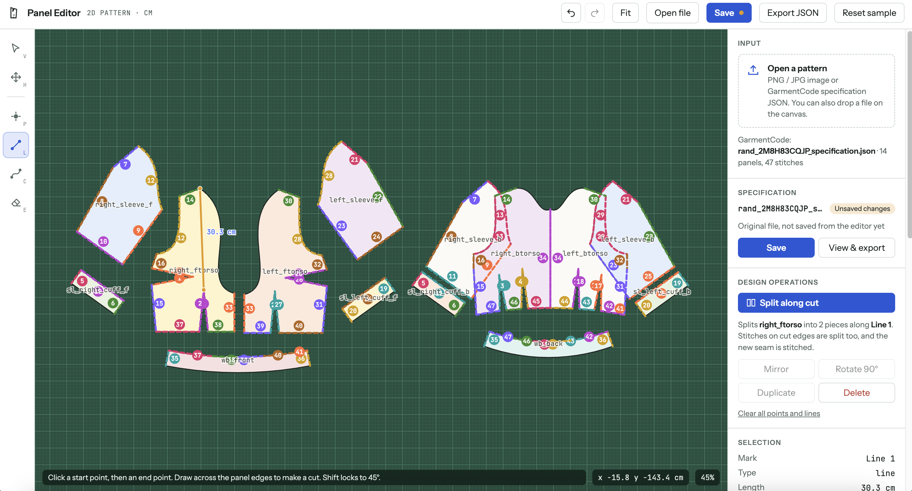
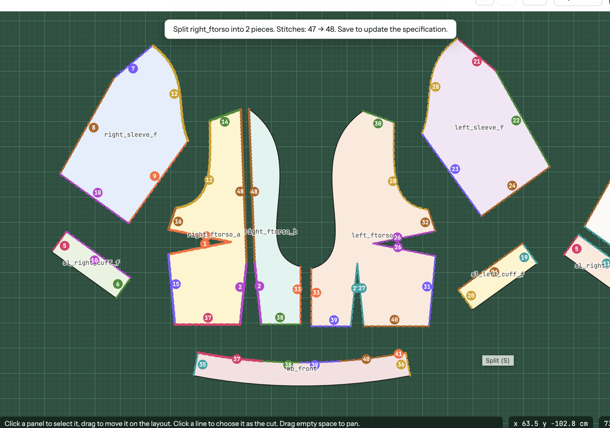

# garment-pattern-editor

A browser-based editor for 2D garment sewing patterns. It reads and writes
[GarmentCode](https://github.com/maria-korosteleva/GarmentCode) specification JSON, lets you draw on
panels and run design operations (split, mirror, rotate, …) while keeping stitches consistent, then
saves the result back to `specification.json`.

Planned: more design operations and a simulation view that shows the garment on a body.

## Run

No build step. ES modules need to be served over HTTP (opening `index.html` from disk won't work):

```bash
npm start            # npx http-server on http://localhost:8000
# or
python3 -m http.server 8000
```

For development tooling: `npm install`, then `npm run lint` and `npm run format`.
See [CLAUDE.md](CLAUDE.md) for architecture, conventions and how to add features.

## Using it

1. **Open a pattern**: *Open file* or drop a file on the canvas.
   - GarmentCode `specification.json`: panels, curved edges (quadratic, cubic, circle) and stitches.
   - PNG / JPG pattern image: outlines are traced into straight-edge panels (no stitches).
     GarmentCode PNG renders use about 3 px per cm.
   - Try `examples/skirt_specification.json` and `examples/skirt_pattern.png`.
2. **Draw** with the toolbox: point (P), line (L), curve (C). Points snap to vertices and edges.
3. **Run a design operation**, e.g. *Split along cut* (S): select a line or curve that crosses a panel.
4. **Save** (Ctrl+S) writes the current pattern into the specification; **Export JSON** shows,
   copies or downloads the last saved version.

## Example: Split along cut

Draw a line across `right_ftorso` (left), then press *Split along cut*: the panel becomes two pieces
and the new seam is stitched (right).

<p>
  
  
</p>
